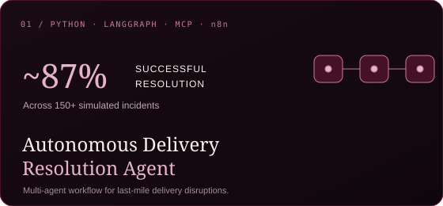
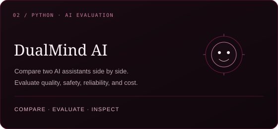
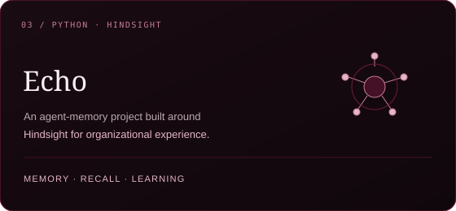
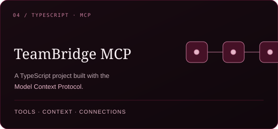
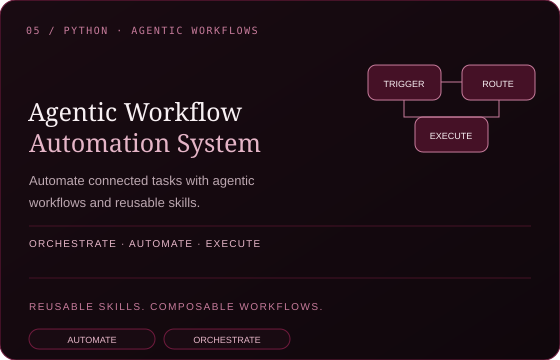
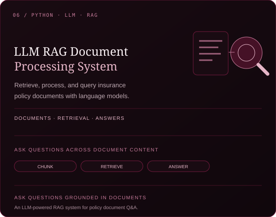

  
  
  
  

AI/ML Engineer working across agentic AI and full-stack development. I enjoy untangling complex systems and building practical software that brings intelligent workflows and reliable engineering together.

<table width="100%">
  <tr>
    <td width="100%"></td>
  </tr>
  <tr>
    <td width="100%"></td>
  </tr>
  <tr>
    <td width="100%"></td>
  </tr>
  <tr>
    <td width="100%"></td>
  </tr>
  <tr>
    <td width="100%"></td>
  </tr>
  <tr>
    <td width="100%"></td>
  </tr>
</table>

Additional selected work: Enterprise Knowledge Agent (Agentic RAG) · Multimodal Document Intelligence Agent · Cross-Platform Food Ordering Application · Reusable Mobile Component Library · High-Performance Restaurant Discovery App

<table align="center" width="100%">
  <tr>
    <td align="center" bgcolor="#10070C">
      
    </td>
  </tr>
</table>

Live public contribution data · rendered by ghchart.rshah.org. No contribution totals, streaks, or language statistics are estimated here.

  
  
  
  

