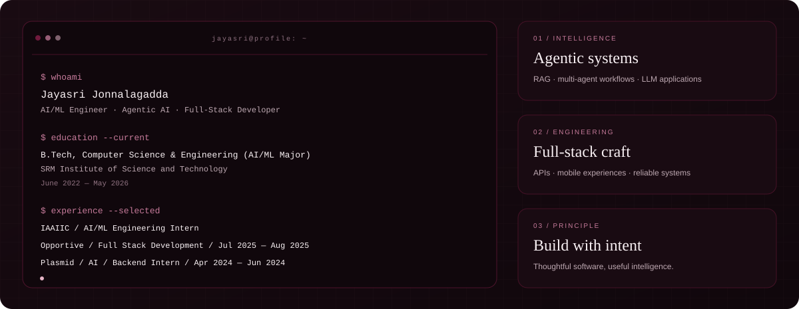
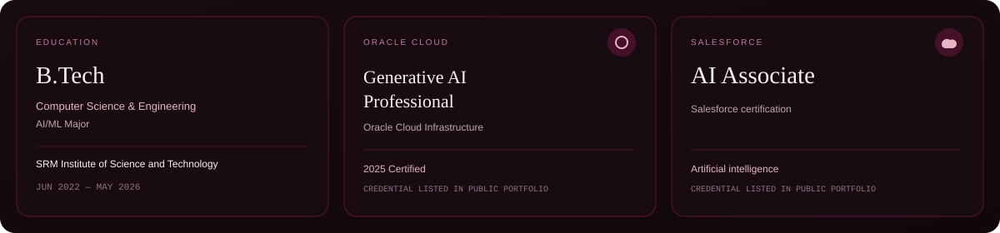
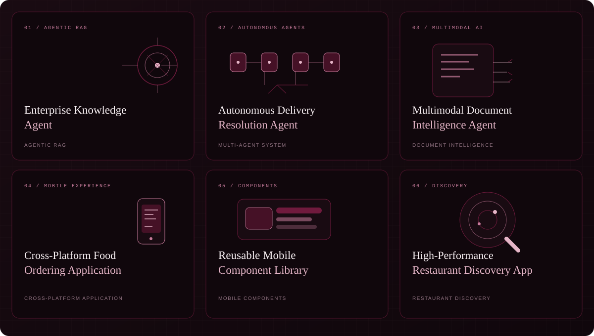
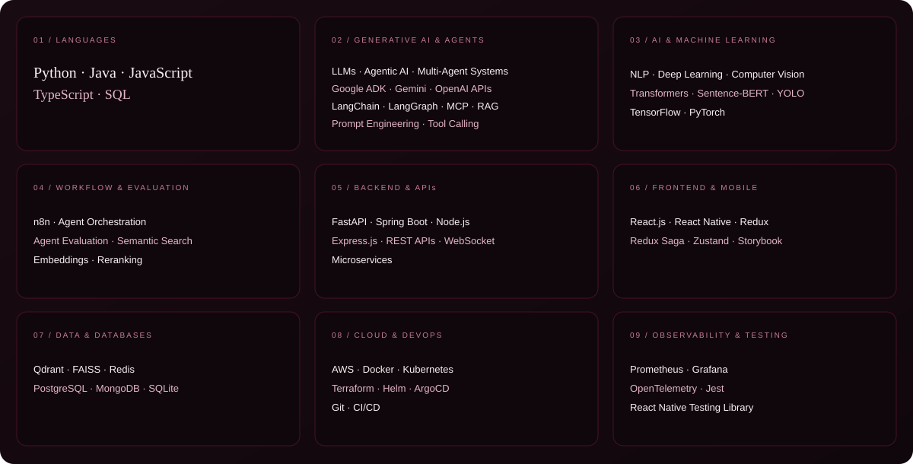

  
  
  
  

AI/ML Engineer working across agentic AI and full-stack development. I enjoy untangling complex systems and building practical software that brings intelligent workflows and reliable engineering together.

  

Only the project repository verified as an exact match is linked. Project cards contain no invented performance metrics.

<table align="center" width="100%">
  <tr>
    <td align="center" bgcolor="#10070C">
      
    </td>
  </tr>
</table>

Live public contribution data · rendered by ghchart.rshah.org. No contribution totals, streaks, or language statistics are estimated here.

  
  
  
  

